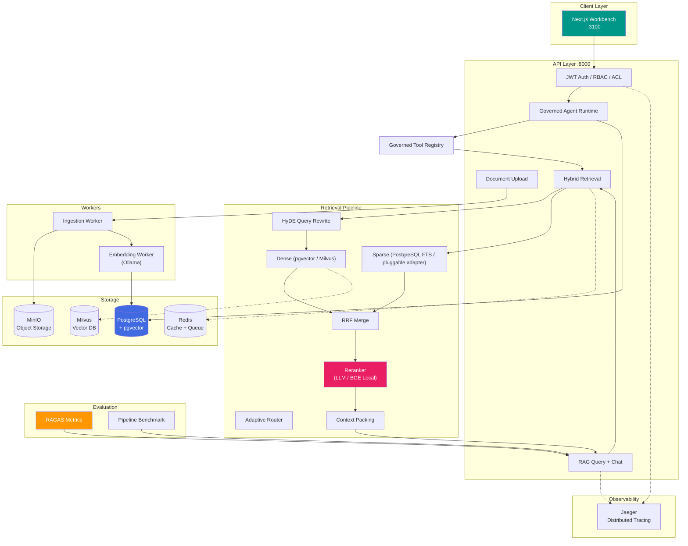

# AegisRAG

[](https://github.com/chyinan/AegisRAG/actions/workflows/ci.yml)
[](https://codecov.io/gh/chyinan/AegisRAG)


**Private RAG with governed Agent tooling, under active pre-1.0 development.**

The current acceptance target is a private-pilot workflow: local login → upload →
indexing → streamed answer → authorized evidence. Start with the
[Compose pilot runbook](docs/operations/PILOT_RUNBOOK.md). Passing mocked contracts
is not proof of production readiness, live infrastructure or real-model quality.

Operational tools now include a [strict HTTP/SSE deployment acceptance probe](docs/operations/DEPLOYMENT_ACCEPTANCE.md), a [read-only upgrade preflight](docs/operations/UPGRADE_CHECKLIST.md), and [authorized recovery of committed embedding handoffs](docs/operations/HANDOFF_RECOVERY.md). They preserve the existing tenant/authentication boundaries and report unverified infrastructure, backup/restore and model evidence explicitly.

AegisRAG is a local-first enterprise knowledge system for teams that need more than "upload files and chat with them." It focuses on secure retrieval, traceable answers, tenant-aware access control, audit logs, provider-neutral LLM orchestration, and controlled tool-calling agents.

The project is intentionally built like an enterprise AI platform: authorization happens before retrieval results reach the model, citations come from authorized context, and all LLM, embedding, vector store, storage, and tool integrations sit behind explicit interfaces.

## Product completion extensions (opt-in)

See the [implementation and validation record](docs/operations/PRODUCT_COMPLETION_VALIDATION.md)
for the exact offline evidence and outstanding target-deployment acceptance gates.

- [Folder sync](docs/FOLDER_SYNC.md), in Knowledge Base: persisted scheduled batches, restart checkpoints,
  status and a managed-source deletion candidate/explicit soft-delete workflow
- [Queue operations](docs/QUEUE_OPERATIONS.md), in Knowledge Base: bounded failed/stale/stuck inspection,
  budget-preserving retries and two-stage running-job termination
- [Durable execution](docs/AGENT_DURABLE_WORKBENCH.md), in Agent Runs: explicit active-time budgets
  up to 3,600 seconds, separate approval expiry and database-backed worker dispatch
- [Task-owned SQL I/O](docs/operations/AGENT_SESSION_LIFETIMES.md): retrieval,
  required tool-call writes and durable evidence no longer capture request sessions
- [Usage costs](docs/USAGE_COST_ACCOUNTING.md), in Review: versioned configured prices, raw
  token ledger, operation/model aggregates, UTC monthly reservations and cost KPIs
- [Frozen domain regression](docs/evaluation/FROZEN_DOMAIN.md): same-generation context
  capture and version-locked synthetic corpus/case/baseline comparisons
- [Deployment operations](docs/operations/PRODUCT_DEPLOYMENT.md): Helm/Compose
  components, lifecycle tooling and explicit installation/upgrade/restore gates
- [Internal support tickets](docs/SUPPORT_TICKET_WORKFLOW.md), in Agent Runs and Review: approval-gated tool creation,
  idempotent records, status lookup and operator resolution

These additions do not enable new services, billing guards, source deletion or
business writes automatically. Background execution requires an installed trusted
current-identity resolver and supervised worker factory. Monetary reservations are
postpaid guardrails, not a provider-invoice hard cap; unknown usage is never free.
Offline tests are contract evidence, not live infrastructure or real-model quality
acceptance. See the [Workbench operations guide](docs/OPERATIONS_WORKBENCH.md) and feature guides
for configuration, user journeys and remaining verification gates.

## Tech Stack

| Layer | Technology |
|-------|-----------|
| **API** | FastAPI, Pydantic v2, structlog |
| **Frontend** | Next.js (TypeScript), Tailwind CSS |
| **Database** | PostgreSQL 17 + pgvector, SQLAlchemy async; exact filtered search (no automatic HNSW provisioning) |
| **Vector DB** | pgvector (default) / Milvus (optional, `--profile milvus`) |
| **Cache / Queue** | Redis (RQ) |
| **Object Storage** | S3-compatible adapter; legacy MinIO Compose service for synthetic local testing only ([maintenance boundary](docs/operations/PILOT_RUNBOOK.md#1-prerequisites-and-configuration)) |
| **Ingestion** | PDF, DOCX, Markdown, TXT, Image (OCR), Scanned PDF — Tesseract / PaddleOCR / Surya; secure folder connector |
| **LLM** | OpenAI-compatible (DeepSeek, Qwen, Ollama) — provider-neutral |
| **Embedding** | nomic-embed-text (768d, Ollama) / OpenAI-compatible |
| **Reranker** | LLM Reranker / BGE Local (BAAI/bge-reranker-v2-m3) / OpenAI-compatible |
| **Retrieval** | Dense + PostgreSQL FTS (ts_rank_cd) + pluggable sparse interface + RRF fusion |
| **Observability** | Prometheus + Grafana (8-panel dashboard) |
| **Evaluation** | Ragas 0.4.3, optional text metrics (Faithfulness, Precision, Recall, Relevancy) |
| **Auth** | Tenant-bound JWT + RBAC + ACL + bcrypt; PostgreSQL FORCE RLS; Redis token revocation/rotation; OIDC/JWKS |
| **OCR** | Provider-neutral adapters — Tesseract by default; PaddleOCR / Surya require an explicitly configured parser registry |
| **Agent** | Governed Tool Registry with schema/permission/rate-limit/audit |
| **CI/CD** | GitHub Actions, pytest contract/failure-injection suites, frontend gates, Codecov |
| **Orchestration** | Docker Compose pilot path; opt-in Helm templates with explicit render/cluster acceptance gates |
| **Tracing** | OpenTelemetry + Jaeger (W3C TraceContext) |

## Feature Demo


The current frontend workbench includes role-aware chat, document import, evidence inspection, retrieval diagnostics, review queues, audit exploration, Agent execution, and settings surfaces for local enterprise RAG workflows.

## Architecture



## Optional framework adapters

Native implementations remain the default. Optional LangChain chat/embedding
components and a real LangGraph Agent runtime reuse the existing provider ports,
governed Tool Registry, authorization, evidence validation and redacted audit
boundaries. Model components and orchestration can be selected independently:

```bash
uv sync --dev --frozen --extra langchain --extra langgraph
# Set separately, after configuring a compatible model provider:
# LLM_ADAPTER=langchain
# EMBEDDING_ADAPTER=langchain
# AGENT_ORCHESTRATION_BACKEND=langgraph
```

LangGraph runs the bounded decision → controlled-tool → validated-result flow.
The integrations also expose governed async Retriever/Runnable/StructuredTool
interfaces, optional model-native tool decisions, and shared Agent SSE progress.
An explicit opt-in durable API adds recovery, human approval and a result ledger;
its real LangGraph checkpoints contain only safe business references. Original
budgets, current permissions and evidence remain authoritative after resume.
No framework speedup or exactly-once side effects are assumed. See
[setup and capability matrix](docs/FRAMEWORK_ADAPTERS.md) and
[durable recovery operations](docs/operations/DURABLE_AGENT.md).

The existing Agent workbench exposes one-shot, live-progress and durable modes.
Its approval controls show exact arguments and refresh current state before a
decision; local interruption is never presented as a confirmed cancellation.
Durable starts retain an in-memory UUID4 recovery key, so a lost first response
can be investigated with an explicit read without repeating execution. A not-found
response is still uncertain; forgetting that view requires an explicit discard
acknowledgement and does not cancel server effects. Keys are not persisted to browser
storage or placed in URLs. See
[workbench behavior](docs/operations/AGENT_WORKBENCH.md),
[the architecture decision](docs/adr/0009-governed-framework-and-recovery.md),
[bounded auxiliary I/O](docs/operations/AGENT_AUXILIARY_IO.md),
[ordinary Agent persistence phases](docs/operations/AGENT_PERSISTENCE_PHASES.md),
[RAG optional audit boundaries](docs/operations/RAG_AUXILIARY_AUDIT.md), and
[the PostgreSQL acceptance gate](docs/operations/DURABLE_DATABASE_ACCEPTANCE.md).
The last gate is an explicit target-environment requirement, not a claim that
local SQLite tests validated PostgreSQL or production infrastructure.

Ordinary Agent create/update plus commit operations now share cooperative phase
budgets (`AGENT_PERSISTENCE_PHASE_TIMEOUT_SECONDS`, default 5 seconds). Lost commit
acknowledgements remain uncertain rather than triggering automatic replay or a
false cancellation receipt. These phases preserve runtime fast cancellation.
The separate [task-owned SQL I/O](docs/operations/AGENT_SESSION_LIFETIMES.md)
composition now isolates retrieval, required tool-call recording and durable
evidence from request-session cleanup; provider/driver timeout limits still apply.

## Concurrency resource boundaries

Ordinary query/chat and ServiceToken chat use operation-owned vector/sparse reads
and hydration. Their read transactions close before reranking or answer generation;
chat user/assistant writes retain their separate commit points. Required query
audits also own independent transactions and cannot commit unrelated memory state.

The API lifespan shares native provider HTTP pools with finite in-flight/waiting
budgets, cancellation cleanup, jittered backoff/Retry-After and total deadlines.
Local BGE loads and inference run in a shared bounded executor. Retrieval cache
pools are reused with complete authorization/metadata identity; singleflight is
conservative and wrapper-local. These changes establish resource-control contracts,
not measured production throughput. See [runtime configuration and limits](docs/operations/CONCURRENCY_RUNTIME.md).

## Benchmarks

The optional Ragas evaluator has offline contracts using real Ragas metric
implementations with mock transports. These establish adapter and error-handling
behavior, not real-model answer quality. Context-dependent metrics require captured
answers with their exact generation contexts; live API mode supports answer
relevancy only. See the [evaluation guide](docs/evaluation.md).

The [sequential pipeline benchmark](docs/operations/PIPELINE_BENCHMARK.md) measures
client-observed successful-request latency and records failed/skipped attempts.
Its completion rate is not concurrent throughput or capacity, and HTTP success
does not establish answer correctness. It retains legacy development identity
headers and must only target an approved isolated development deployment.

The [closed-loop HTTP load utility](docs/operations/LOAD_MEASUREMENT.md)
now records per-run success/error counts, a shared dispatch window and actual
elapsed time including drain. Its latency samples include failed attempts and
retain a different historical percentile algorithm from the sequential tool.
A failed, partial or empty run exits nonzero. These tested measurement contracts
are not a newly measured workload, quality score or capacity claim.

The opt-in [mixed target load utility](docs/operations/CONCURRENCY_ACCEPTANCE.md)
adds authenticated multi-identity short/long query/chat and SSE workloads, slow
readers, planned disconnects, staged cache labels and external ingestion overlap.
Its offline protocol tests are not a real target/model performance result.

[Historical README figures](docs/evaluation/HISTORICAL_BENCHMARKS.md) are retained
with their missing-provenance limitations. No current quality, latency, capacity
or production-readiness claim is based on those figures. New operator results
need a matching revision, workload, provider configuration and environment record.

## Quickstart: private pilot

Use Docker Compose v2 and an interactive terminal. Copy `.env.example` to `.env`,
replace the required secret placeholders, keep the three database roles distinct,
and start with fake LLM/embedding/rerank providers. Fake outputs verify plumbing,
not answer quality. Keep development auth headers disabled.

```bash
docker compose --env-file .env -f docker/compose.yaml config --quiet
docker compose --env-file .env -f docker/compose.yaml up -d --build
docker compose --env-file .env -f docker/compose.yaml --profile bootstrap run --rm bootstrap \
  --tenant-id default --tenant-name "Default Tenant" --admin-username admin
```

The final command prompts for the first administrator password without echoing it.
It is explicit and idempotent: rerunning verifies the original identity and never
resets a password or promotes an existing user. Conflicting existing identities
are refused. The older demo seed is not the pilot setup path.

Open `http://localhost:3100` and sign in with the initialized tenant, username and
password. Upload Markdown/TXT using Tenant or Private ACL, wait for the returned
version's `retrieval_ready` status, ask a question, and open its citation. Department
upload is explicitly unavailable; it is never silently widened to Tenant.
Live indexing status requires `document:manage` and shows bounded status checks,
attempts/retry timing and safe error codes. Refreshing status does not start a job.

The Web client follows the actual backend SSE contract (`delta`, nested citation,
`success/error` plus `no_answer`). Failed/interrupted answers remain visibly failed
and non-copyable, including when restored from chat history. Inline citations bind
exact backend-derived document/version/chunk IDs, independently of mention order
or ranking; saved histories reconstruct the same IDs. Unknown or legacy unbound
markers never open arbitrary evidence. Navigation and new conversations cancel
stale requests; evidence resolves again under the current identity. Transient source
read failures offer localized manual [Retry source](docs/operations/SOURCE_RECOVERY.md)
without restarting chat or losing the answer, session or draft.

For role/migration ordering, host development with explicit `uv run --env-file`,
real-provider endpoints, health checks, troubleshooting, browser tests and validation
limits, follow the [pilot runbook](docs/operations/PILOT_RUNBOOK.md).

### Kubernetes status

The experimental Helm chart now includes worker deployments, migration/role
initialization, optional bundled MinIO and monitoring workloads, with
external-service-safe defaults. Actual Helm rendering, cluster installation,
PVC behavior and target acceptance remain unverified. Follow the
[Helm guide](helm/aegisrag/README.md) and
[deployment/recovery procedure](docs/operations/PRODUCT_DEPLOYMENT.md);
neither these manifests nor the Compose pilot path constitute a production sign-off.

## Highlights

### 🔒 Enterprise Security by Default
Tenant isolation, RBAC, ACL filtering, soft-delete awareness, and backend-enforced permissions applied **before** retrieved context reaches the LLM. The LLM never decides authorization.

### 📊 Auditable RAG Workflows
RAG and Agent audit events carry request/trace and tenant/user IDs, latency and status, with operation-specific retrieval, citation, model, usage and error details where available. Some audit hooks are [best-effort](docs/operations/RAG_AUXILIARY_AUDIT.md) and may be absent after failure or timeout. Token usage is provider/adapter-dependent; LangChain embeddings explicitly mark it unavailable.

### 🧠 Advanced Retrieval Pipeline
- **HyDE Query Rewriting** — optional hypothetical-answer query expansion; quality and latency tradeoffs require workload-specific evaluation
- **Hybrid Search** — dense (pgvector / Milvus) + PostgreSQL FTS with RRF fusion; branch execution is parallel when adapters have independent sessions and automatically serializes shared SQLAlchemy sessions
- **LLM Reranker / BGE Local** — reuse a configured LLM scorer or run a local BGE model (`BAAI/bge-reranker-v2-m3`). Model resources, latency and quality need target-environment validation. Set `RERANK_PROVIDER=bge_local` to select the local adapter.
- **Graph RAG prototype** — standalone experimental module, not wired into API ingestion or hybrid retrieval; the reserved `GRAPH_RAG_*` settings do not activate a third retrieval branch
- **Adaptive Query Routing** — opt-in (`ADAPTIVE_ROUTING_ENABLED=true`, off by default); heuristic classification routes factual queries to dense-only retrieval and complex queries to hybrid retrieval with configured reranking
- **Semantic Chunking** — embedding-similarity segmentation through explicit `SemanticChunker` injection; the normal worker uses fixed-size chunking, and `SEMANTIC_CHUNKING_ENABLED` does not activate this path

### 🔍 Provider-Neutral OCR
Tesseract, PaddleOCR and Surya adapters share an `OCRProvider` interface. The settings-aware factory accepts `OCR_PROVIDER=tesseract|paddle|surya`, but the normal ingestion worker uses Tesseract; selecting another backend requires an explicitly configured parser registry. Includes security controls: PDF page caps, decompression bomb protection, configurable timeouts.

The `FolderConnector` accepts only supported document extensions, enforces a byte cap,
rejects symlink escapes, and emits a stable tenant/connector/relative-path identity
while retaining SHA-256 solely for change detection and versioning.
The Compose deployment mounts the connector root read-only; direct Windows deployments
should use an equivalent read-only ACL because kernel-level `openat(O_NOFOLLOW)` is not
available on that platform.
RQ ingestion/embedding jobs also use deterministic `job_id` values plus bounded retries.

### 🧪 Reproducible Engineering Checks
The checked-in GitHub Actions workflow runs lint, unit/integration tests, deterministic
evaluation gates and optional-framework contracts. The framework matrix selects
five-component locked, minimum and latest-compatible profiles. The ToolNode import
guard distinguishes an absent LangGraph distribution from broken installed
LangGraph/prebuilt imports. The local Python 3.12 acceptance records exact tested
minimum and latest-compatible tuples in [Framework adapters](docs/FRAMEWORK_ADAPTERS.md#local-version-edge-evidence-2026-10-15);
it does not establish every allowed version combination or hosted Python 3.11 execution.
Dependency metadata alone is insufficient. Framework compatibility and physical-database
gates are separate checks with explicit dependencies. Review
artifacts document particular changes; this repository does not implement the
previously advertised automatic 12-agent, score-based review pipeline.

### 🛠️ Governed Agent Tooling
Agents execute through a Tool Registry with schema, permission, timeout, rate limit, and audit boundaries. Not arbitrary function calls.

### 📈 Built-in Evaluation
- **RAGAS integration** — Faithfulness, Context Precision, Context Recall, Answer Relevancy
- **CI smoke gates** — automated eval runs on every push/PR (20-case smoke + 224-case extended)
- **Extended eval dataset** — 224 deterministic, versioned queries across 6 domains: tech docs, policy compliance, ops manuals, product knowledge, security audit, multi-hop. Placeholder corpus records are rejected before a gate can run.
- **Pipeline benchmark** — sequential latency percentiles, independent endpoint failure accounting and nonzero incomplete-run exits; no throughput or quality inference
- **Coverage tracking** — via pytest-cov + Codecov

## Documentation

- [Technical Overview](docs/technical-overview.md) — architecture, retrieval pipeline, reranker config, Agent governance
- [Framework Integration Contracts](docs/FRAMEWORK_ADAPTERS.md) — independent adapters, governed ecosystem exports, native tool decisions and compatibility CI
- [Durable Agent Operations](docs/operations/DURABLE_AGENT.md) — opt-in checkpoints, approval, recovery boundaries and retention
- [Evaluation Guide](docs/evaluation.md) — Ragas text metrics, captured generation contexts and supported CLI
- [Sequential Benchmark Guide](docs/operations/PIPELINE_BENCHMARK.md) — development-only invocation, schema 2, failure counts and measurement limits
- [Observability & Monitoring](docs/operations/observability.md) — Prometheus metrics, Grafana dashboard, load testing
- [Production Readiness Runbook](docs/operations/production-readiness.md) — release gates, real-provider SLO checks, backup/restore, tenant security, incident response
- [Local Development](docs/operations/local-development.md) — environment setup, Docker, migrations, workers
- [Enterprise RAG Walkthrough](docs/demo/enterprise-rag-walkthrough.md) — synthetic demo corpus
- [API Docs](docs/api/upload.md) — upload and API contracts
- [Technical Preferences](docs/TECHNICAL_PREFERENCES.md) — production-grade implementation rules
- [Architecture Decision Records](docs/adr/) — key design decisions

## Why AegisRAG

Most RAG examples optimize for a fast answer. AegisRAG optimizes for answers that can be **governed, traced, debugged, and defended**.

- Retrieval filtered by tenant, RBAC, ACL, metadata, soft-delete, and active-state **before** chunks reach the LLM
- Citations extracted from authorized context — never trusting model-generated references
- Prompt boundaries treat user input, documents, web content, and tool output as untrusted
- Client UIs are entry points, not authorization boundaries — backend remains authoritative
- Provider-neutral architecture — swap LLMs, embeddings, vector stores without touching business logic

## Project Structure

```text
apps/
  api/                 FastAPI routes, dependency assembly, factories
  worker/              RQ ingestion and embedding workers
  web/                 Next.js enterprise workbench (TypeScript)
packages/
  auth/                Auth context, RBAC, ACL policy
  common/              Config, errors, envelope, audit, logging, circuit breaker
  data/                Storage models, repositories, document lifecycle
  ingestion/           Parsers, cleaners, dedup, chunkers (fixed + semantic),
                       OCR providers (Tesseract / PaddleOCR / Surya — Protocol-based)
  embeddings/          Provider-neutral embedding ports, Ollama adapter
  vectorstores/        Vector store port, pgvector + Milvus adapters
  retrieval/           Dense, sparse, RRF, rerank (LLM + OpenAI-compat), 
                       query rewrite (HyDE), query router (adaptive), cache,
                       standalone experimental Graph RAG (not API-integrated)
  rag/                 Context packing, prompts, generation, citations, chat
  agent/               Tool registry, runtime, tools, audit persistence
  memory/              Chat session memory
  eval/                RAGAS evaluator, benchmark runner
tests/
  unit/                Component and application-service tests (counts depend on selected extras)
  integration/         API, storage, worker, and Docker contract tests
  eval/                Smoke datasets and regression gates
```

## Evaluation and Tests

```powershell
# Lint + type-check
uv run ruff check .

# Unit + integration tests (with coverage)
uv run pytest tests/unit tests/integration

# Supported Ragas CLI (requires explicit dataset/captured responses and judge setup)
# See docs/evaluation.md; offline unit tests do not contact a judge

# Sequential benchmark: approved development target only; see guide first
python -m evaluation.benchmark_pipeline --api-url http://127.0.0.1:8000

# CI smoke gate
uv run python -m tests.eval.rag.run_ci_smoke \
  --dataset tests/eval/datasets/rag_smoke.json \
  --config tests/eval/config/rag_smoke_gate.json

# Extended eval gate (224 queries, 6 domains)
uv run python -m tests.eval.rag.run_ci_smoke --extended
```

Tests use fake providers and mocks by default. Coverage tracked via Codecov.
The repository policy requires non-regressing project coverage and 100% coverage
of new coverable patch lines, with no path exclusions. CI keeps the aggregated
`coverage.xml`, `.coverage`, and `coverage-provenance.json` as a seven-day artifact
after the final test phase; provenance distinguishes partial failed runs from
complete reports. Upload errors fail the backend job. A successful upload is not
itself a coverage-threshold verdict: Codecov must also publish its project/patch
statuses through the repository's existing GitHub integration. This change does
not install the Codecov GitHub App or alter branch protection or account access.
The Python report still covers `packages` and `apps`; separate frontend checks
and evaluation/script contracts are not a claim of whole-repository coverage.
Durable framework checkpoints fail closed and wake dependent writes when their
owner is cancelled or a predecessor fails, including inserts that never start.
The cancellation probe retains its five-second entry budget and 0.5-second
post-loss cancellation assertion; startup stalls have separate controlled tests
and bounded, content-free lease/heartbeat diagnostics.
The default fake LLM returns fixed text and cannot pass the strict deployment
probe's known-answer and canonical-citation assertions; approving/configuring a
local or other suitable provider is an operator prerequisite. The pytest process
disables Ragas analytics before test-module imports, so delayed background/exit
flushes cannot outlive a per-test opt-out. Standalone evaluation still requires
the explicit private-execution configuration documented for that command.

```bash
uv run python -m scripts.deployment_acceptance --help
uv run python -m scripts.check_upgrade_readiness --help
```

The upgrade preflight is read-only. An `automated_status=PASS` still leaves restore
rehearsal and write-quiescence evidence `UNVERIFIED`; it never applies migrations.
The Web CI job also runs desktop/mobile Chromium contract tests after its production
build, using fixtures generated from backend DTO/SSE serializers. Image publication
waits for both backend and Web gates. See the runbook for browser setup and for the
separate live-stack acceptance checklist.

## Authentication

| Mode | Use Case |
|------|----------|
| **Local Login** | Tenant-bound, versioned JWT login with bcrypt-hashed credentials. Usernames and groups are unique within a tenant; seed passwords are random. |
| **Dev Headers** | `ENABLE_DEV_AUTH_HEADERS=true` for local development. |
| **JWT / Service Tokens** | External client integration with RBAC. |

## Current Limits

- Pre-1.0 private-pilot target; no production-readiness certification
- Agent retrieval, required tool-call persistence and evidence rehydration use operation-owned sessions, including finite late completion after fast cancellation. Infinite cancellation-resistant custom code still requires provider/driver timeouts and process supervision; live database/pool acceptance remains unverified
- Browser contract/SQLite/ASGI tests do not prove live PostgreSQL, Redis, MinIO or model behavior
- Bounded handoff recovery can re-deliver an unstarted committed embedding job after ingestion retries expire; it is not an automatic outbox sweeper, general failed-job reset or killed-worker recovery
- Full target-stack acceptance, coordinated database/object-store restore rehearsals, load/failure testing and real-model quality still require deployment-specific evidence
- Web login currently supports local credentials; pasted-JWT sign-in is disabled until verified identity hydration exists
- Web access-token expiry returns to sign-in and clears authenticated UI/cache state. Explicit sign-out clears local state immediately, then confirms server revocation only from a successful `/auth/logout` response; failure/timeout is reported as local-only
- Automatic browser token refresh remains out of scope. Credentials stay in memory only; reloading or expiry requires signing in again
- Helm workers, migrations, MinIO and monitoring configuration are implemented but remain experimental and unverified on a real cluster; use the documented isolated deployment acceptance procedure
- Web crawling outside current scope
- PostgreSQL FORCE RLS, distributed token revocation/rotation, and enterprise OIDC/JWKS are implemented; real PostgreSQL black-box verification runs when `AEGISRAG_RLS_*` test DSNs are provided

## Contributing

Production-grade changes over demos. Before adding a feature: check module boundaries, keep routes thin, use provider abstractions, add tests, update docs.
