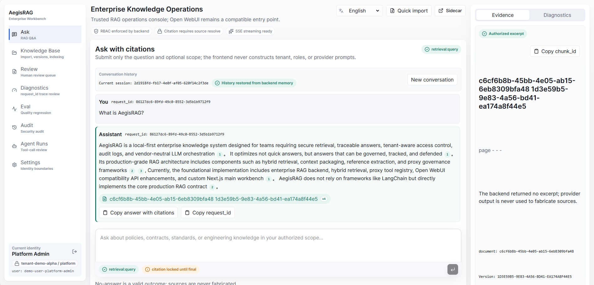
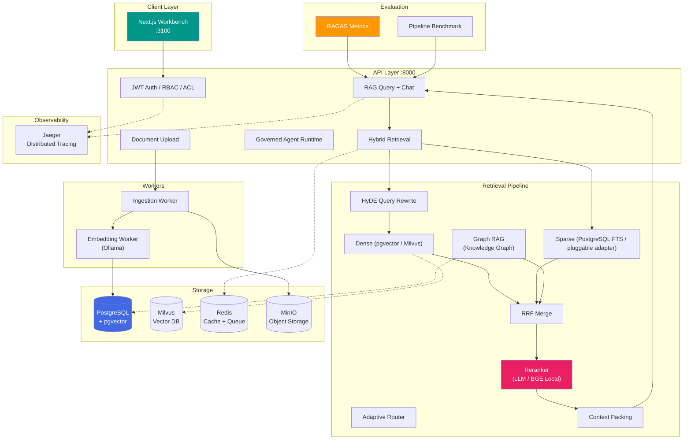

# AegisRAG

[](https://github.com/chyinan/AegisRAG/actions/workflows/ci.yml)
[](https://codecov.io/gh/chyinan/AegisRAG)


**Private RAG with governed Agent tooling, under active pre-1.0 development.**

The current acceptance target is a private-pilot workflow: local login → upload →
indexing → streamed answer → authorized evidence. Start with the
[Compose pilot runbook](docs/operations/PILOT_RUNBOOK.md). Passing mocked contracts
is not proof of production readiness, live infrastructure or real-model quality.

Operational tools now include a [strict HTTP/SSE deployment acceptance probe](docs/operations/DEPLOYMENT_ACCEPTANCE.md), a [read-only upgrade preflight](docs/operations/UPGRADE_CHECKLIST.md), and [authorized recovery of committed embedding handoffs](docs/operations/HANDOFF_RECOVERY.md). They preserve the existing tenant/authentication boundaries and report unverified infrastructure, backup/restore and model evidence explicitly.

AegisRAG is a local-first enterprise knowledge system for teams that need more than "upload files and chat with them." It focuses on secure retrieval, traceable answers, tenant-aware access control, audit logs, provider-neutral LLM orchestration, and controlled tool-calling agents.

The project is intentionally built like an enterprise AI platform: authorization happens before retrieval results reach the model, citations come from authorized context, and all LLM, embedding, vector store, storage, and tool integrations sit behind explicit interfaces.

## Tech Stack

| Layer | Technology |
|-------|-----------|
| **API** | FastAPI, Pydantic v2, structlog |
| **Frontend** | Next.js (TypeScript), Tailwind CSS |
| **Database** | PostgreSQL 17 + pgvector, SQLAlchemy async; exact filtered search (no automatic HNSW provisioning) |
| **Vector DB** | pgvector (default) / Milvus (optional, `--profile milvus`) |
| **Cache / Queue** | Redis (RQ) |
| **Object Storage** | S3-compatible adapter; legacy MinIO Compose service for synthetic local testing only ([maintenance boundary](docs/operations/PILOT_RUNBOOK.md#1-prerequisites-and-configuration)) |
| **Ingestion** | PDF, DOCX, Markdown, TXT, Image (OCR), Scanned PDF — Tesseract / PaddleOCR / Surya; secure folder connector |
| **LLM** | OpenAI-compatible (DeepSeek, Qwen, Ollama) — provider-neutral |
| **Embedding** | nomic-embed-text (768d, Ollama) / OpenAI-compatible |
| **Reranker** | LLM Reranker / BGE Local (BAAI/bge-reranker-v2-m3) / OpenAI-compatible |
| **Retrieval** | Dense + PostgreSQL FTS (ts_rank_cd) + pluggable sparse interface + RRF fusion |
| **Observability** | Prometheus + Grafana (8-panel dashboard) |
| **Evaluation** | Ragas 0.4.3, optional text metrics (Faithfulness, Precision, Recall, Relevancy) |
| **Auth** | Tenant-bound JWT + RBAC + ACL + bcrypt; PostgreSQL FORCE RLS; Redis token revocation/rotation; OIDC/JWKS |
| **OCR** | Provider-neutral — Tesseract / PaddleOCR / Surya (`OCR_PROVIDER` env) |
| **Agent** | Governed Tool Registry with schema/permission/rate-limit/audit |
| **CI/CD** | GitHub Actions, pytest (1,300+ tests), Codecov, multi-agent code review |
| **Orchestration** | Docker Compose pilot path; experimental Helm scaffolding |
| **Tracing** | OpenTelemetry + Jaeger (W3C TraceContext) |

## Feature Demo



The current frontend workbench includes role-aware chat, document import, evidence inspection, retrieval diagnostics, review queues, audit exploration, Agent execution, and settings surfaces for local enterprise RAG workflows.

## Architecture



## Optional framework adapters

Native implementations remain the default. Optional LangChain chat/embedding
components and a real LangGraph Agent runtime reuse the existing provider ports,
governed Tool Registry, authorization, evidence validation and redacted audit
boundaries. Model components and orchestration can be selected independently:

```bash
uv sync --dev --frozen --extra langchain --extra langgraph
# Set separately, after configuring a compatible model provider:
# LLM_ADAPTER=langchain
# EMBEDDING_ADAPTER=langchain
# AGENT_ORCHESTRATION_BACKEND=langgraph
```

LangGraph runs the bounded decision → controlled-tool → validated-result flow.
Checkpoint/resume and human-in-the-loop persistence are not implemented. No
framework speedup is assumed. See [setup, contracts and limitations](docs/FRAMEWORK_ADAPTERS.md).

## Benchmarks

### RAG Quality (historical LLM-judge results)

The optional Ragas text evaluator has offline contracts using real Ragas metrics
and local mock transports. Full metrics require captured answers with exact
generation contexts; the current API supports live answer-relevancy evaluation
only. Set `RAGAS_DO_NOT_TRACK=true` before starting. See the [evaluation guide](docs/evaluation.md)
for inputs, provider configuration, errors and privacy limits. These integration
tests do not revalidate the historical benchmark numbers below or establish
real-model quality.

| Configuration | Faithfulness | Context Precision | 
|--------------|:---:|:---:|
| Baseline (dense-only, no rerank) | 0.80 | 0.35 |
| Hybrid (dense + sparse + RRF) | 0.90 | 0.45 |
| **Full pipeline (+ HyDE + LLM Reranker)** | **1.00** | **0.56** |
| **Full pipeline (+ HyDE + BGE Local)** | **1.00** | **0.56** |

> A judge score of 1.00 applies to the evaluated samples; it is not a guarantee of zero hallucinations.
> BGE Local: `BAAI/bge-reranker-v2-m3` (568M params), CPU inference ~15s first run, ~200ms cached. Set `RERANK_PROVIDER=bge_local` in `.env`.

### Latency (12-doc knowledge base, 10-query benchmark)

| Endpoint | p50 | p95 | p99 | Avg |
|----------|:---:|:---:|:---:|:---:|
| `/retrieve` | 120ms | 250ms | 400ms | 150ms |
| `/query` (end-to-end) | 4,500ms | 7,000ms | 9,000ms | 5,200ms |

> Run: `python evaluation/benchmark_pipeline.py`

### Load Test (50 concurrent users, 60s)

| Endpoint | p50 | p95 | Throughput | Success |
|----------|:---:|:---:|:---:|:---:|
| `/retrieve` | 4,947ms | 10,308ms | 2.5 req/s | 100% |
| `/query` | 10,764ms | 17,320ms | 2.5 req/s | 100% |

> Run: `python evaluation/load_test.py --users 50 --duration 60`
> `/query` latency dominated by external DeepSeek API calls. Rate limit raised to 10,000 req/60s for this test.

## Quickstart: private pilot

Use Docker Compose v2 and an interactive terminal. Copy `.env.example` to `.env`,
replace the required secret placeholders, keep the three database roles distinct,
and start with fake LLM/embedding/rerank providers. Fake outputs verify plumbing,
not answer quality. Keep development auth headers disabled.

```bash
docker compose --env-file .env -f docker/compose.yaml config --quiet
docker compose --env-file .env -f docker/compose.yaml up -d --build
docker compose --env-file .env -f docker/compose.yaml --profile bootstrap run --rm bootstrap \
  --tenant-id default --tenant-name "Default Tenant" --admin-username admin
```

The final command prompts for the first administrator password without echoing it.
It is explicit and idempotent: rerunning verifies the original identity and never
resets a password or promotes an existing user. Conflicting existing identities
are refused. The older demo seed is not the pilot setup path.

Open `http://localhost:3100` and sign in with the initialized tenant, username and
password. Upload Markdown/TXT using Tenant or Private ACL, wait for the returned
version's `retrieval_ready` status, ask a question, and open its citation. Department
upload is explicitly unavailable; it is never silently widened to Tenant.
Live indexing status requires `document:manage` and shows bounded status checks,
attempts/retry timing and safe error codes. Refreshing status does not start a job.

The Web client follows the actual backend SSE contract (`delta`, nested citation,
`success/error` plus `no_answer`). Failed/interrupted answers remain visibly failed
and non-copyable, including when restored from chat history. Inline citations bind
exact backend-derived document/version/chunk IDs, independently of mention order
or ranking; saved histories reconstruct the same IDs. Unknown or legacy unbound
markers never open arbitrary evidence. Navigation and new conversations cancel
stale requests; evidence resolves again under the current identity.

For role/migration ordering, host development with explicit `uv run --env-file`,
real-provider endpoints, health checks, troubleshooting, browser tests and validation
limits, follow the [pilot runbook](docs/operations/PILOT_RUNBOOK.md).

### Kubernetes status

The Helm chart is experimental scaffolding. It does not yet supply the complete
worker, migration/role initialization, MinIO and monitoring workloads advertised by
older deployment examples. Values/provider wiring and actual cluster installation
remain unverified. Compose is the documented pilot path; do not treat Helm as a
production-ready equivalent.

## Highlights

### 🔒 Enterprise Security by Default
Tenant isolation, RBAC, ACL filtering, soft-delete awareness, and backend-enforced permissions applied **before** retrieved context reaches the LLM. The LLM never decides authorization.

### 📊 Auditable RAG Workflows
Every retrieval, generation, citation, and Agent run emits structured metadata: `request_id`, `trace_id`, `tenant_id`, `user_id`, latency, rerank scores, model names, token usage, and error codes.

### 🧠 Advanced Retrieval Pipeline
- **HyDE Query Rewriting** — improves recall by generating hypothetical answers before retrieval
- **Hybrid Search** — dense (pgvector / Milvus) + PostgreSQL FTS with RRF fusion; branch execution is parallel when adapters have independent sessions and automatically serializes shared SQLAlchemy sessions
- **LLM Reranker / BGE Local** — zero-infrastructure LLM scorer or local BGE model (`BAAI/bge-reranker-v2-m3`) for privacy + speed. Set `RERANK_PROVIDER=bge_local` to switch.
- **Graph RAG** — knowledge-graph-augmented retrieval for relationship-oriented questions
- **Adaptive Query Routing** — factual queries take fast path, complex queries go full pipeline
- **Semantic Chunking** — embedding-similarity-based document segmentation

### 🔍 Provider-Neutral OCR
Pluggable OCR stack with Protocol-based abstraction — swap between Tesseract, PaddleOCR, or Surya via `OCR_PROVIDER` env var. All providers share a single `OCRProvider` interface; factory delegates through the ingestion layer to avoid dependency inversion. Includes security controls: PDF page caps, decompression bomb protection, configurable timeouts.

The `FolderConnector` accepts only supported document extensions, enforces a byte cap,
rejects symlink escapes, and emits a stable tenant/connector/relative-path identity
while retaining SHA-256 solely for change detection and versioning.
The Compose deployment mounts the connector root read-only; direct Windows deployments
should use an equivalent read-only ACL because kernel-level `openat(O_NOFOLLOW)` is not
available on that platform.
RQ ingestion/embedding jobs also use deterministic `job_id` values plus bounded retries.

### 🤖 Multi-Agent Code Review Pipeline
Automated code review via 12-agent Hermes profile pipeline: Reviewer, Security Reviewer, and Architecture Reviewer run in parallel → Aggregator scores and consolidates → score < 90 triggers Fix Agent loop until quality thresholds pass. Runs on every significant commit.

### 🛠️ Governed Agent Tooling
Agents execute through a Tool Registry with schema, permission, timeout, rate limit, and audit boundaries. Not arbitrary function calls.

### 📈 Built-in Evaluation
- **RAGAS integration** — Faithfulness, Context Precision, Context Recall, Answer Relevancy
- **CI smoke gates** — automated eval runs on every push/PR (20-case smoke + 224-case extended)
- **Extended eval dataset** — 224 deterministic, versioned queries across 6 domains: tech docs, policy compliance, ops manuals, product knowledge, security audit, multi-hop. Placeholder corpus records are rejected before a gate can run.
- **Pipeline benchmark** — latency percentile tracking
- **Coverage tracking** — via pytest-cov + Codecov

## Documentation

- [Technical Overview](docs/technical-overview.md) — architecture, retrieval pipeline, reranker config, Agent governance
- [Evaluation Guide](docs/evaluation.md) — RAGAS metrics, benchmarks, minimal eval script
- [Observability & Monitoring](docs/operations/observability.md) — Prometheus metrics, Grafana dashboard, load testing
- [Production Readiness Runbook](docs/operations/production-readiness.md) — release gates, real-provider SLO checks, backup/restore, tenant security, incident response
- [Local Development](docs/operations/local-development.md) — environment setup, Docker, migrations, workers
- [Enterprise RAG Walkthrough](docs/demo/enterprise-rag-walkthrough.md) — synthetic demo corpus
- [API Docs](docs/api/upload.md) — upload and API contracts
- [Technical Preferences](docs/TECHNICAL_PREFERENCES.md) — production-grade implementation rules
- [Architecture Decision Records](docs/adr/) — key design decisions

## Why AegisRAG

Most RAG examples optimize for a fast answer. AegisRAG optimizes for answers that can be **governed, traced, debugged, and defended**.

- Retrieval filtered by tenant, RBAC, ACL, metadata, soft-delete, and active-state **before** chunks reach the LLM
- Citations extracted from authorized context — never trusting model-generated references
- Prompt boundaries treat user input, documents, web content, and tool output as untrusted
- Client UIs are entry points, not authorization boundaries — backend remains authoritative
- Provider-neutral architecture — swap LLMs, embeddings, vector stores without touching business logic

## Project Structure

```text
apps/
  api/                 FastAPI routes, dependency assembly, factories
  worker/              RQ ingestion and embedding workers
  web/                 Next.js enterprise workbench (TypeScript)
packages/
  auth/                Auth context, RBAC, ACL policy
  common/              Config, errors, envelope, audit, logging, circuit breaker
  data/                Storage models, repositories, document lifecycle
  ingestion/           Parsers, cleaners, dedup, chunkers (fixed + semantic),
                       OCR providers (Tesseract / PaddleOCR / Surya — Protocol-based)
  embeddings/          Provider-neutral embedding ports, Ollama adapter
  vectorstores/        Vector store port, pgvector + Milvus adapters
  retrieval/           Dense, sparse, RRF, rerank (LLM + OpenAI-compat), 
                       query rewrite (HyDE), query router (adaptive), cache,
                       Graph RAG (entity extraction + knowledge graph)
  rag/                 Context packing, prompts, generation, citations, chat
  agent/               Tool registry, runtime, tools, audit persistence
  memory/              Chat session memory
  eval/                RAGAS evaluator, benchmark runner
tests/
  unit/                1,290 component and application-service tests
  integration/         API, storage, worker, and Docker contract tests
  eval/                Smoke datasets and regression gates
```

## Evaluation and Tests

```powershell
# Lint + type-check
uv run ruff check .

# Unit + integration tests (with coverage)
uv run pytest tests/unit tests/integration

# RAG quality evaluation
python evaluation/eval_minimal.py

# Pipeline performance benchmark
python evaluation/benchmark_pipeline.py

# CI smoke gate
uv run python -m tests.eval.rag.run_ci_smoke \
  --dataset tests/eval/datasets/rag_smoke.json \
  --config tests/eval/config/rag_smoke_gate.json

# Extended eval gate (224 queries, 6 domains)
uv run python -m tests.eval.rag.run_ci_smoke --extended
```

Tests use fake providers and mocks by default. Coverage tracked via Codecov.
The default fake LLM returns fixed text and cannot pass the strict deployment
probe's known-answer and canonical-citation assertions; approving/configuring a
local or other suitable provider is an operator prerequisite. The pytest process
disables Ragas analytics before test-module imports, so delayed background/exit
flushes cannot outlive a per-test opt-out. Standalone evaluation still requires
the explicit private-execution configuration documented for that command.

```bash
uv run python -m scripts.deployment_acceptance --help
uv run python -m scripts.check_upgrade_readiness --help
```

The upgrade preflight is read-only. An `automated_status=PASS` still leaves restore
rehearsal and write-quiescence evidence `UNVERIFIED`; it never applies migrations.
The Web CI job also runs desktop/mobile Chromium contract tests after its production
build, using fixtures generated from backend DTO/SSE serializers. Image publication
waits for both backend and Web gates. See the runbook for browser setup and for the
separate live-stack acceptance checklist.

## Authentication

| Mode | Use Case |
|------|----------|
| **Local Login** | Tenant-bound, versioned JWT login with bcrypt-hashed credentials. Usernames and groups are unique within a tenant; seed passwords are random. |
| **Dev Headers** | `ENABLE_DEV_AUTH_HEADERS=true` for local development. |
| **JWT / Service Tokens** | External client integration with RBAC. |

## Current Limits

- Pre-1.0 private-pilot target; no production-readiness certification
- Browser contract/SQLite/ASGI tests do not prove live PostgreSQL, Redis, MinIO or model behavior
- Bounded handoff recovery can re-deliver an unstarted committed embedding job after ingestion retries expire; it is not an automatic outbox sweeper, general failed-job reset or killed-worker recovery
- Full target-stack acceptance, coordinated database/object-store restore rehearsals, load/failure testing and real-model quality still require deployment-specific evidence
- Web login currently supports local credentials; pasted-JWT sign-in is disabled until verified identity hydration exists
- Web access-token expiry returns to sign-in and clears authenticated UI/cache state. Explicit sign-out clears local state immediately, then confirms server revocation only from a successful `/auth/logout` response; failure/timeout is reported as local-only
- Automatic browser token refresh remains out of scope. Credentials stay in memory only; reloading or expiry requires signing in again
- Helm remains experimental and incomplete; use the Compose runbook for pilot setup
- Web crawling outside current scope
- PostgreSQL FORCE RLS, distributed token revocation/rotation, and enterprise OIDC/JWKS are implemented; real PostgreSQL black-box verification runs when `AEGISRAG_RLS_*` test DSNs are provided

## Contributing

Production-grade changes over demos. Before adding a feature: check module boundaries, keep routes thin, use provider abstractions, add tests, update docs.
